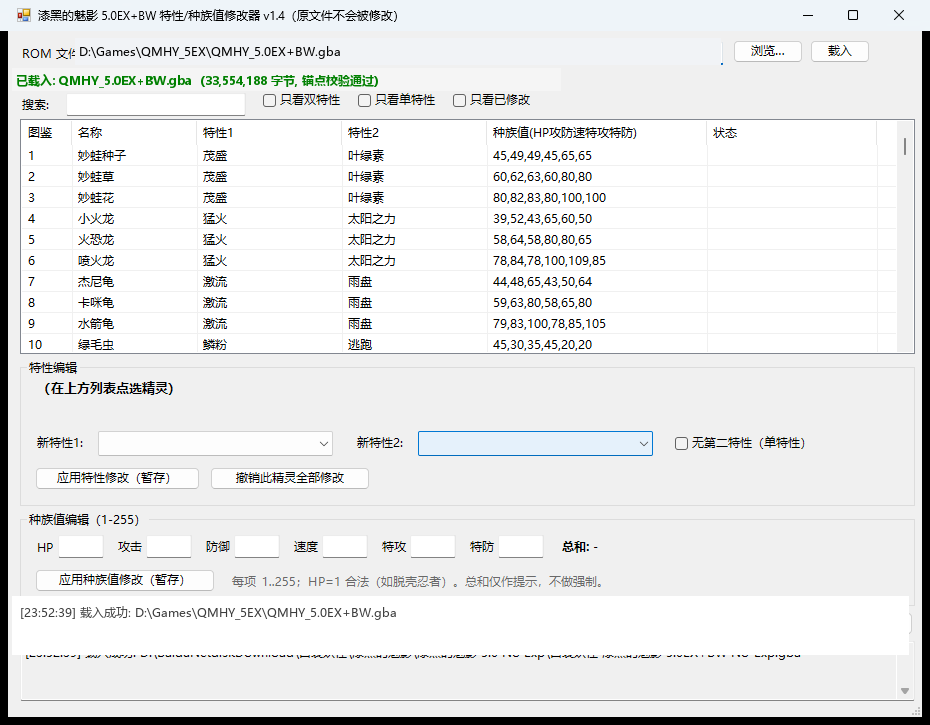

# 漆黑的魅影 5.0EX+BW 特性/种族值修改器

一个零依赖的 Windows 桌面小工具，用于查看和修改 GBA 改版
**《口袋妖怪 漆黑的魅影 5.0EX+BW (No-Exp)》** 中每只宝可梦的特性（Ability），
并**另存为新的 .gba 文件**——原文件永远不会被写入。

## 特性

- 🎮 **图形界面**：PowerShell + WinForms，Windows 10/11 原生自带运行时，无需安装任何东西
- 📋 **全量清单**：内置 411 条种族值数据，精灵名单 100% 命名（官方译名 + ROM 内部名表互证），支持搜索与筛选（双特性 / 单特性 / 已修改）
- ✏️ **自由改特性**：**148 个官方特性**全部可选（引擎 1..150 全解码），支持改为单特性（自动按改版"复写"约定写入）
- 🔢 **种族值编辑**：HP/攻击/防御/速度/特攻/特防逐项修改（1..255 校验、总和实时显示），与特性修改混合导出
- 🛡️ **安全设计**：
  - 打开 ROM 时进行 7 点锚点校验（种族值字节），非目标 ROM 直接拒绝载入
  - 只写新文件，导出时若选择原文件名会被拦截
  - 导出后自动复读新文件，验证完整性、修改字节落位、锚点仍成立
- 🖱️ **拖放载入**：把 .gba 拖进窗口即可
- 🔎 **透明可查**：每一处修改都记录到日志（槽位 / 文件偏移 / 字节变化）

## 使用方法

1. 双击 `AbilityEditor.bat`（或右键 `AbilityEditor.ps1` → 使用 PowerShell 运行）
2. 点「浏览…」选择你的 ROM，或直接把 .gba 拖进窗口
3. 在列表中选中精灵 → 选择新特性 → 「应用修改（暂存）」
4. 点「导出新 ROM (.gba)…」，得到 `xxx_MOD.gba`，丢进模拟器即可验证

> 脚本默认执行策略可能拦截 ps1，`AbilityEditor.bat` 已用
> `-ExecutionPolicy Bypass` 处理；也可手动：
> `powershell -NoProfile -ExecutionPolicy Bypass -File AbilityEditor.ps1`

### 可选

设置环境变量 `ABILITY_EDITOR_ROM` 指向 .gba 文件，启动时自动载入（方便自动化）。

## 工作原理（简述）

底层数据来自对 ROM 的静态逆向分析，详细技术笔记见
[docs/ABILITY_TABLE.md](docs/ABILITY_TABLE.md)：

- 种族值表位于 `0x3203E8`，每条 28 字节（Gen3 引擎标准结构），
  `+0x16 / +0x17` 字节为特性1 / 特性2（引擎编号）
- 判定规则：`特性2 ≠ 0 且 ≠ 特性1` → 双特性；
  `特性2 = 0` 或与特性1 相同（复写）→ 单特性
- 改版重排了表内顺序并插入了 Gen4/Gen5 精灵；411 条目身份由
  「种族值+捕获率+性别比+孵化周期+友好度+成长曲线+蛋群」与官方数据库交叉比对、
  邻序一致性推断、ROM 内部名表（`内部编号 = 槽位 + 303`）三方互证
- **引擎特性编号 1..150 全解码**：ROM 特性名表（0x01 恶臭..0x4C 杂音、0x4D 气闸、
  0x4E 恶作剧之心..0x8E 分析）+ 官方数据库约束求解 + 实测确认，三源零冲突

## 兼容性

| ROM | 是否支持 |
|---|---|
| 漆黑的魅影 5.0EX+BW No-Exp（33,554,188 字节） | ✅ 目标版本 |
| 其他版本（4.5 / EX+DP / 官方绿宝石等） | ❌ 锚点校验会拒绝 |

其他变体只需换一组表基址与锚点签名即可支持，欢迎 PR。

## 已知限制

- 少数槽位是改版自调数据（种族值与官方不同），名单以 ROM 内部名表为准
- 只修改特性，不修改种族值 / 图鉴 / 进化等（原理相同，扩展容易）
- 建议用 mGBA / VBA-M 验证；实机烧录卡请先在模拟器确认

## 免责声明

本项目**不包含、也不分发任何 ROM 或游戏资源**，仅包含工具代码与公开的
游戏数据知识（种族值 / 特性等事实性数据）。请自备合法获得的游戏文件。
本项目与 Game Freak / Nintendo / The Pokémon Company 及改版原作者无关，
仅供学习与技术研究，请勿用于商业用途。

## 致谢

本仓库由 **GLM-5.3-Flash (AutoClaw)** 协助建立——包括 ROM 逆向分析、种族值/特性数据提取、修改器开发与文档撰写。

## License

[MIT](LICENSE)
